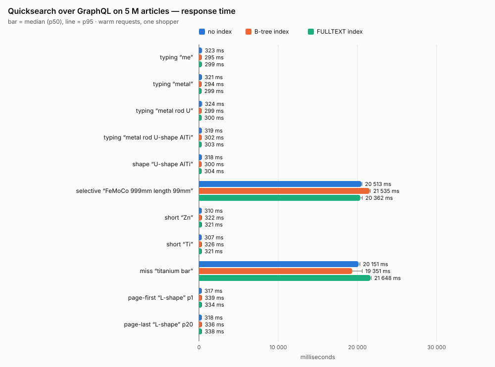
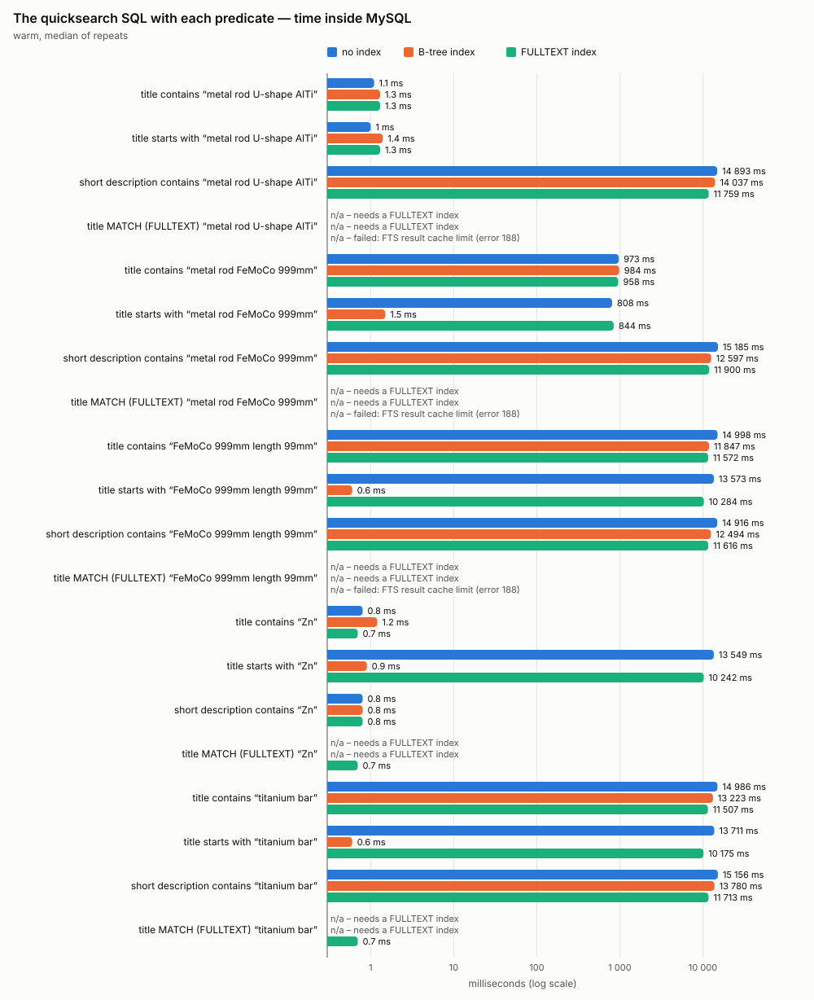
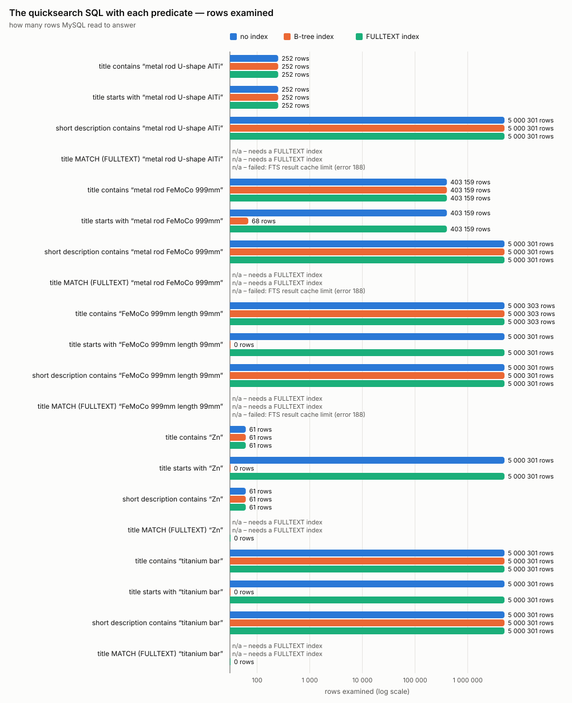

# Does indexing `oxarticles.OXTITLE` / `OXSHORTDESC` speed up the quicksearch on 5 M articles?

**Date:** 2026-10-20 · **Sprint:** [17](../../sprints/sprint-17-search-index-perf.md) · **Branch:** `feature/search-index-perf` (oxid-fe-user)
**Working data** (raw CSV, logs, 5 M-row TSV chunks): `oxid-fe-user/test-results/performance/` — gitignored, and **Playwright empties `test-results/` on every e2e run**; everything there is reproducible (see _Reproduce_).

## Answer

**No — not for the quicksearch as it is built.** The quicksearch sends `products(filter: { title: { contains: $q } })`, which
the shop turns into `OXTITLE LIKE '%q%'`. Neither a B-tree nor a FULLTEXT index can serve a leading wildcard, so with
either index the request times stay where they were: **~0.3 s** when the term is frequent, **~20 s** when it is rare or matches nothing.

| Quicksearch over GraphQL, p50                         |   no index | B-tree index | FULLTEXT index |
| ----------------------------------------------------- | ---------: | -----------: | -------------: |
| frequent terms (typing, shape, short, pages; 9 cases) | 307–324 ms |   294–339 ms |     299–338 ms |
| rare term `FeMoCo 999mm length 99mm`                  |     20.5 s |       21.5 s |         20.4 s |
| no match `titanium bar`                               |     20.2 s |       19.4 s |         21.6 s |

What an index _would_ buy, measured on the same query in MySQL (§ Findings 3–5):

- **B-tree on `OXTITLE` + a prefix search (`beginsWith`)**: the worst case drops from **13.5 s to under 2 ms** (5 000 301 → ≤ 68 rows examined).
- **B-tree on `OXSHORTDESC`**: nothing — the quicksearch never filters on it, and `contains` on it stays a full scan for rare terms in every run.
- **FULLTEXT**: not usable on this catalogue as is — phrase searches with the words every title shares (`metal`, `rod`, `length`) fail with
  `ERROR 188 FTS query exceeds result cache limit`, and the 2-letter materials (`Zn`, `Fe`, `Ti`, …) are below `innodb_ft_min_token_size` = 3.

## Setup

| Item      | Value                                                                                                                                                               |
| --------- | ------------------------------------------------------------------------------------------------------------------------------------------------------------------- |
| Host      | Intel i7-12700H (20 threads), 15.3 GiB RAM, NVMe; Docker SDK; PHP 8.3, OXID 7.4 + graphql-storefront                                                                |
| MySQL     | 8.0.43, SDK defaults during every measurement: `innodb_buffer_pool_size` **128 MiB**, redo 100 MiB, `innodb_ft_min_token_size` 3                                    |
| Database  | `example_perf`, a clone of the demo shop's `example`, served by its own Apache vhost on `:8094` (the demo shop was never written to)                                |
| Catalogue | **5 000 243** articles in `oxarticles` (**7.7 GB** data + indexes): the 242 demo articles, a marker, and **5 000 000 rods**                                         |
| Rods      | seeded sample (seed `20261020`) of the matrix 1000 lengths × 100 diameters × 5 shapes × 17 materials = 8.5 M: every value appears                                   |
| Titles    | `metal rod Fe 120mm length 8mm diameter`, `metal rod U-shape AlTiMg 3mm length 1mm diameter`; short description `FeCo rod, T-shape, 450 mm long, 12 mm in diameter` |

### Method

- **GraphQL (what the shopper waits for):** the storefront's own `SEARCH_QUERY`, limits and `normalizeTerm`, imported — not copied — from
  `plugins/shop/search/`. Suggestions ask `limit 5`, results pages `limit 13` at `offset page × 12`. Per scenario: 3 warm-up requests (the first is
  reported as _cold_), then up to 30 timed sequential requests, stopping early once a 60 s budget is spent (minimum 5). One client, no concurrency.
- **SQL probes (why):** the statement graphql-storefront actually sends (captured from `performance_schema`), with only the title predicate swapped:
  `contains` (`LIKE '%q%'`), `beginsWith` (`LIKE 'q%'`), `OXSHORTDESC LIKE '%q%'` and `MATCH … AGAINST ('"q"' IN BOOLEAN MODE)`. Time and rows
  examined come from `performance_schema.events_statements_history`; the plan from `EXPLAIN`. 1 cold + 2 warm executions, warm median reported.
- **Runs:** `none` → add B-tree (`KEY OXTITLE_PERF (OXTITLE)`, `KEY OXSHORTDESC_PERF (OXSHORTDESC)`) → measure → drop → add FULLTEXT on each column →
  measure → drop. MySQL is restarted before each run (empty buffer pool), and a test asserts the schema holds exactly that run's indexes.

## Results

### Quicksearch over GraphQL



p50 (p95) in milliseconds, warm requests. Cold first requests and p99 are in `raw/*.csv`.

| Scenario                             |            no index |        B-tree index |      FULLTEXT index |
| ------------------------------------ | ------------------: | ------------------: | ------------------: |
| typing “me”                          |       323 (p95 359) |       295 (p95 323) |       299 (p95 348) |
| typing “metal”                       |       321 (p95 347) |       294 (p95 309) |       299 (p95 302) |
| typing “metal rod U”                 |       324 (p95 370) |       299 (p95 313) |       300 (p95 308) |
| typing “metal rod U-shape AlTi”      |       319 (p95 326) |       302 (p95 316) |       303 (p95 312) |
| shape “U-shape AlTi”                 |       318 (p95 329) |       300 (p95 309) |       304 (p95 310) |
| selective “FeMoCo 999mm length 99mm” | 20 513 (p95 20 579) | 21 535 (p95 21 626) | 20 362 (p95 20 629) |
| short “Zn”                           |       310 (p95 321) |       322 (p95 345) |       321 (p95 341) |
| short “Ti”                           |       307 (p95 313) |       326 (p95 335) |       321 (p95 331) |
| miss “titanium bar”                  | 20 151 (p95 20 325) | 19 351 (p95 20 617) | 21 648 (p95 21 754) |
| page-first “L-shape” p1              |       317 (p95 325) |       339 (p95 352) |       334 (p95 343) |
| page-last “L-shape” p20              |       318 (p95 328) |       336 (p95 352) |       338 (p95 349) |

### The quicksearch SQL inside MySQL





**Time inside MySQL** (milliseconds, warm median; n/a gives the reason — see finding 5):

| Scenario                                              |                     no index |                 B-tree index |                                   FULLTEXT index |
| ----------------------------------------------------- | ---------------------------: | ---------------------------: | -----------------------------------------------: |
| title contains “metal rod U-shape AlTi”               |                          1.1 |                          1.3 |                                              1.3 |
| title starts with “metal rod U-shape AlTi”            |                            1 |                          1.4 |                                              1.3 |
| short description contains “metal rod U-shape AlTi”   |                       14 893 |                       14 037 |                                           11 759 |
| title MATCH (FULLTEXT) “metal rod U-shape AlTi”       | n/a (needs a FULLTEXT index) | n/a (needs a FULLTEXT index) | n/a (failed: FTS result cache limit (error 188)) |
| title contains “metal rod FeMoCo 999mm”               |                          973 |                          984 |                                              958 |
| title starts with “metal rod FeMoCo 999mm”            |                          808 |                          1.5 |                                              844 |
| short description contains “metal rod FeMoCo 999mm”   |                       15 185 |                       12 597 |                                           11 900 |
| title MATCH (FULLTEXT) “metal rod FeMoCo 999mm”       | n/a (needs a FULLTEXT index) | n/a (needs a FULLTEXT index) | n/a (failed: FTS result cache limit (error 188)) |
| title contains “FeMoCo 999mm length 99mm”             |                       14 998 |                       11 847 |                                           11 572 |
| title starts with “FeMoCo 999mm length 99mm”          |                       13 573 |                          0.6 |                                           10 284 |
| short description contains “FeMoCo 999mm length 99mm” |                       14 916 |                       12 494 |                                           11 616 |
| title MATCH (FULLTEXT) “FeMoCo 999mm length 99mm”     | n/a (needs a FULLTEXT index) | n/a (needs a FULLTEXT index) | n/a (failed: FTS result cache limit (error 188)) |
| title contains “Zn”                                   |                          0.8 |                          1.2 |                                              0.7 |
| title starts with “Zn”                                |                       13 549 |                          0.9 |                                           10 242 |
| short description contains “Zn”                       |                          0.8 |                          0.8 |                                              0.8 |
| title MATCH (FULLTEXT) “Zn”                           | n/a (needs a FULLTEXT index) | n/a (needs a FULLTEXT index) |                                              0.7 |
| title contains “titanium bar”                         |                       14 986 |                       13 223 |                                           11 507 |
| title starts with “titanium bar”                      |                       13 711 |                          0.6 |                                           10 175 |
| short description contains “titanium bar”             |                       15 156 |                       13 780 |                                           11 713 |
| title MATCH (FULLTEXT) “titanium bar”                 | n/a (needs a FULLTEXT index) | n/a (needs a FULLTEXT index) |                                              0.7 |

**Rows examined:**

| Scenario                                              |                     no index |                 B-tree index |                                   FULLTEXT index |
| ----------------------------------------------------- | ---------------------------: | ---------------------------: | -----------------------------------------------: |
| title contains “metal rod U-shape AlTi”               |                          252 |                          252 |                                              252 |
| title starts with “metal rod U-shape AlTi”            |                          252 |                          252 |                                              252 |
| short description contains “metal rod U-shape AlTi”   |                    5 000 301 |                    5 000 301 |                                        5 000 301 |
| title MATCH (FULLTEXT) “metal rod U-shape AlTi”       | n/a (needs a FULLTEXT index) | n/a (needs a FULLTEXT index) | n/a (failed: FTS result cache limit (error 188)) |
| title contains “metal rod FeMoCo 999mm”               |                      403 159 |                      403 159 |                                          403 159 |
| title starts with “metal rod FeMoCo 999mm”            |                      403 159 |                           68 |                                          403 159 |
| short description contains “metal rod FeMoCo 999mm”   |                    5 000 301 |                    5 000 301 |                                        5 000 301 |
| title MATCH (FULLTEXT) “metal rod FeMoCo 999mm”       | n/a (needs a FULLTEXT index) | n/a (needs a FULLTEXT index) | n/a (failed: FTS result cache limit (error 188)) |
| title contains “FeMoCo 999mm length 99mm”             |                    5 000 303 |                    5 000 303 |                                        5 000 303 |
| title starts with “FeMoCo 999mm length 99mm”          |                    5 000 301 |                            0 |                                        5 000 301 |
| short description contains “FeMoCo 999mm length 99mm” |                    5 000 301 |                    5 000 301 |                                        5 000 301 |
| title MATCH (FULLTEXT) “FeMoCo 999mm length 99mm”     | n/a (needs a FULLTEXT index) | n/a (needs a FULLTEXT index) | n/a (failed: FTS result cache limit (error 188)) |
| title contains “Zn”                                   |                           61 |                           61 |                                               61 |
| title starts with “Zn”                                |                    5 000 301 |                            0 |                                        5 000 301 |
| short description contains “Zn”                       |                           61 |                           61 |                                               61 |
| title MATCH (FULLTEXT) “Zn”                           | n/a (needs a FULLTEXT index) | n/a (needs a FULLTEXT index) |                                                0 |
| title contains “titanium bar”                         |                    5 000 301 |                    5 000 301 |                                        5 000 301 |
| title starts with “titanium bar”                      |                    5 000 301 |                            0 |                                        5 000 301 |
| short description contains “titanium bar”             |                    5 000 301 |                    5 000 301 |                                        5 000 301 |
| title MATCH (FULLTEXT) “titanium bar”                 | n/a (needs a FULLTEXT index) | n/a (needs a FULLTEXT index) |                                                0 |

### Cost of the indexes (5 M rows)

| Index    | Build time | Size on disk |
| -------- | ---------: | -----------: |
| btree    |      127 s |      955 MiB |
| fulltext |     1039 s |      297 MiB |

The shop's own 16 secondary indexes took 595 s to rebuild after the bulk load (see `load.log`).

## Findings

1. **A request costs ~300 ms before the database matters.** Frequent terms are answered by MySQL in about 1 ms (the plan walks `OXSORT` and stops
   after 61–252 rows), yet the GraphQL request takes 295–340 ms in every run. That floor is PHP, the shop bootstrap and GraphQL — no index touches it.
2. **Rare and missing terms cost ~20 s, with or without an index.** `LIKE '%q%'` must look at every row until 5 match; for a rare term or a typo that
   is all 5 000 301 rows: ~10–15 s inside MySQL, ~20 s for the GraphQL request. Neither index changes the plan
   (`oxarticles:index:OXSORT | t2s:eq_ref:OXMAPIDX …` in all three runs).
3. **The B-tree on `OXTITLE` helps only a prefix search.** With it, `beginsWith` switches to `range:OXTITLE_PERF`:
   `metal rod FeMoCo 999mm` 808 ms / 403 159 rows → **1.5 ms / 68 rows**; terms no title starts with 13.5 s / 5 M rows → **< 1 ms / 0 rows**.
   For frequent prefixes the optimizer keeps the cheaper `OXSORT`/`parentsort` walk (~1 ms either way).
4. **The B-tree on `OXSHORTDESC` buys nothing here**: the quicksearch never filters on it, and a `contains` on it is a full scan in every run for any term that is not frequent (11.6–15.2 s warm).
5. **FULLTEXT does not fit near-identical titles.** The quicksearch's `LIKE` ignores it (GraphQL times unchanged). Asked directly with
   `MATCH … AGAINST` (a phrase, the closest counterpart of `contains`):
   - every phrase containing a word all 5 M titles share — `metal rod U-shape AlTi`, `metal rod FeMoCo 999mm`, `FeMoCo 999mm length 99mm` —
     fails with **`ERROR 188 FTS query exceeds result cache limit`**: InnoDB first collects the document list of each word, and `metal`, `rod`,
     `length` each list all 5 M articles;
   - `Zn` answers in 0.7 ms with **0 rows although 294 183 Zn rods exist**: tokens shorter than `innodb_ft_min_token_size` (3) are not indexed —
     8 of the 17 materials are 2 letters;
   - only `titanium bar` (rare words, no match) is answered correctly, in 0.7 ms.

   Building it took **17.3 min** (B-tree: 2.1 min).

6. **The shop's views decide the plan.** `oxv_oxarticles_1_de` joins `oxarticles2shop` on `OXMAPID`, and the list is ordered by `oxsort`: MySQL walks
   `oxarticles` in `OXSORT` order and checks the shop mapping per row. Any index under test must beat that walk — the B-tree does so only for selective prefixes.

## Recommendation

- **Do not add the two indexes for the quicksearch as it is.** They change nothing a shopper notices and cost ~1 GB of disk (B-tree) or a 17-minute,
  table-rebuilding build (FULLTEXT), plus write overhead on every article save.
- **If the ~20 s worst case matters** (it does: a typo is a full scan), the options, in order of effort:
  1. **Prefix search + B-tree on `OXTITLE`** — storefront switches `contains` → `beginsWith`, one index: worst case < 2 ms in MySQL. Cost: "sensor"
     no longer finds "Parking sensor PDC" (the trade-off Sprint 13 declined); for catalogues whose titles start with the product word it is natural.
  2. **A search engine** (OpenSearch/Elasticsearch behind a module or service) — the scalable answer for infix and fuzzy search; out of this sprint's scope.
  3. **FULLTEXT** — only with a changed GraphQL filter (core change), `ngram` or stop-word tuning for the shared words, and a solution for 2-letter tokens.
- Independently, the scan itself is bounded by the SDK's **128 MiB buffer pool against a 7.7 GB table**; production-sized memory shortens it but does not remove it.

## Limits

- **One machine, one client, warm OS page cache.** MySQL was restarted before each run, but the host's page cache was not dropped: "cold" means cold InnoDB.
- **Few samples for the slow cases:** the 20 s scenarios hit the 60 s budget after the 5-sample minimum; their spread (p95 within 3 % of p50) makes that acceptable.
- **The FULLTEXT SQL probes were resumed after a host crash** (out of memory during the run, 2026-10-20 ~14:20). For the resumed probes
  `innodb_ft_result_cache_limit` was lowered from 2 GB to 256 MiB so the failing phrase searches stop early; this changes when error 188 is
  raised, not whether. The GraphQL part of the FULLTEXT run had completed before the crash.
- **Full scans in the FULLTEXT probes are faster (10–12 s vs 13–15 s) with an identical plan**: those probes ran on the freshly rebooted host
  with ~8 GB of free OS page cache (before: ~1.5 GB). It is the environment, not the index; compare runs by plan and rows examined, not by those seconds.
- **FULLTEXT size** counts the `fts_*` tablespaces only; adding the first FULLTEXT index also rebuilds the table with a hidden `FTS_DOC_ID` column.
- **Only language 0** (`OXTITLE`, view `_de`) was measured.

## Reproduce

From `oxid-fe-user/` with the Docker SDK running (one-time: the `:8094` vhost in `containers/httpd/project.conf`, port `8094` in compose, and
`config.inc.php` reading `OXID_DB_NAME` — see sprint 17, S1):

```bash
scripts/perf/search-index/db-clone.sh                                                  # example → example_perf
npx jiti scripts/perf/search-index/generate-tsv.ts --out test-results/performance/rods # 5 M rows, sorted by OXID
npx jiti scripts/perf/search-index/load-rods.ts --tsv-dir test-results/performance/rods --log test-results/performance/load.log
PERF_GRAPHQL_URL=http://localhost:8094/graphql/ npx vitest run tests/unit/perf         # environment + loaded catalogue
scripts/perf/search-index/run-sprint.sh                                                 # none → btree → fulltext (≈ 1.5 h)
npx jiti scripts/perf/search-index/build-report.ts --raw test-results/performance/raw \
  --dir docs/dev_log/20261020/reports/search-index-perf
```

Clean up: `docker compose exec mysql mysql -uroot -proot -e 'DROP DATABASE example_perf'` and `rm -r test-results/performance`.
